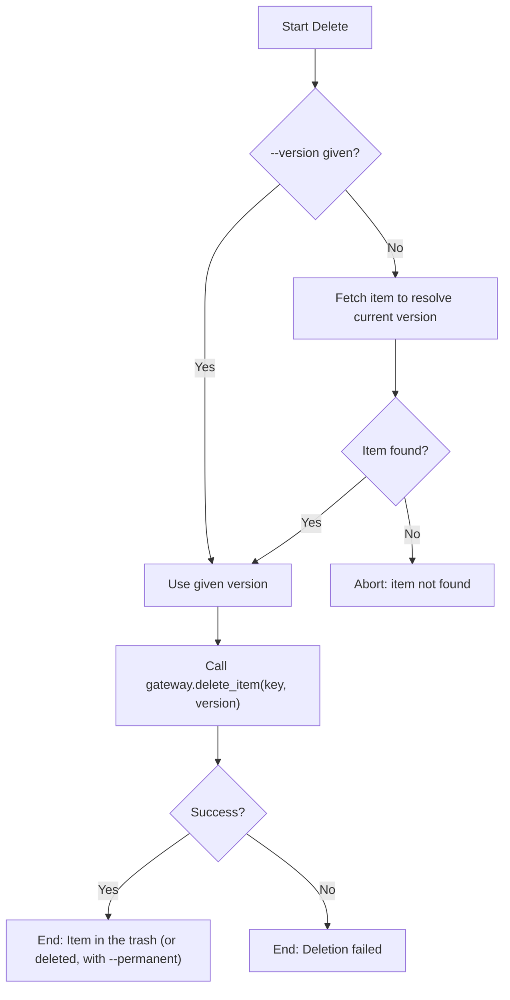

# DOC-SPEC: item delete

## 1. Classification
- **Level:** 🔴 DESTRUCTIVE (Recoverable by default; `--permanent` is final)
- **Target Audience:** Researcher / Library Manager

## 2. Logic Flow (Visual Synthesis)

## 3. Synopsis
Moves a single item to Zotero's trash by key (or deletes it for good with `--permanent`). Previews until `--execute`.

## 4. Description (Instructional Architecture)
By default `item delete` does what Zotero Desktop's delete does: it sets the item's `deleted` flag through the Web API (Issue #402), so the item goes to Zotero's trash, keeps its collections, and `item restore` (or Desktop) brings it back. This is the same operation as `item trash`.

With `--permanent` it calls the Web API's item `DELETE` endpoint instead: a hard removal, not Zotero's recoverable trash. Once deleted, the item's key is gone; any external document (e.g. a citation manager) referencing that key will break.

If `--version` is omitted, the command first fetches the item to resolve its current version (needed for Zotero's optimistic-locking write), then deletes it. If the item can't be found, nothing is deleted.

This command discards the item outright. If the goal is instead to consolidate a genuine duplicate into another item - keeping its tags, notes, and attachments rather than losing them - use `item merge` instead, which unions the surviving data before deleting the folded-in duplicate.

## 5. Parameter Matrix
| Flag / Parameter | Type | Description | Ergonomic Note |
| :--- | :--- | :--- | :--- |
| `--key` | String | The Zotero Item Key to delete | Required. |
| `--version` | Integer | Delete only if the item is still at this version | Optional - defaults to the item's current version. If the item changed since, nothing is deleted and the command exits 1. |
| `--execute` | Flag | Delete the item | Mutually exclusive with `--dry-run`. Without it only a preview is shown (Issue #462). |
| `--dry-run` | Flag | Preview the item and its children without deleting | Mutually exclusive with `--execute`. |
| `--trash` | Flag | Move the item to Zotero's trash (recoverable) | The default; accepted so scripts written for 3.x keep working. |
| `--permanent` | Boolean | Delete the item for good instead of trashing it | Optional. Default: False. Not recoverable. Can't be combined with `--trash`. |

## 6. Scenario-Based Examples (Cognitive Anchors)
### Scenario: Removing a mistakenly-added test/junk record
**Problem:** I manually added a test item (`JUNK_01`) by mistake and want it gone from my library view, with a way back if I was wrong.
**Action:** `zotero-cli item delete --key "JUNK_01" --execute`
**Result:** The item is in Zotero's trash (and Desktop's); `item restore --key "JUNK_01" --execute` brings it back.

### Scenario: Deleting for good
**Problem:** I'm sure `JUNK_01` should be gone entirely, not just moved to the trash.
**Action:** `zotero-cli item delete --key "JUNK_01" --permanent --execute`
**Result:** The item is permanently removed from the library. This cannot be undone.

### Scenario: Checking what a delete would remove first
**Problem:** I want to see the item and its attached notes/files before committing to a delete.
**Action:** `zotero-cli item delete --key "JUNK_01" --dry-run`
**Result:** The item and its children are listed; nothing is deleted.

## 7. Cognitive Safeguards
- **Common Failure Modes:** Assuming this behaves like Zotero Desktop's trash (recoverable) - it does not. Using this to resolve a duplicate when `item merge` (which preserves tags/notes/attachments before deleting) would better fit the goal.
- **Safety Tips:** Always verify the item key with `item inspect` before deleting. Without `--execute` nothing is changed: you get a preview (`--dry-run` is the explicit spelling). `--permanent` cannot be undone.
